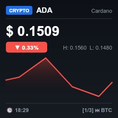
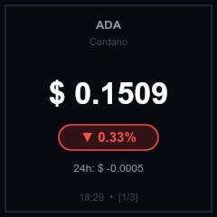
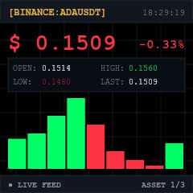

# ⏱️ GeekMagic SmallTV — Market Monitor

Monitor financeiro em tempo real com painel web local para os relógios inteligentes **GeekMagic SmallTV** (SmallTV-PRO / SmallTV-Ultra e derivados ESP8266/ESP32 com display IPS 240×240).

Exibe cotações, variações de 24h, métricas de máxima/mínima e gráficos (*sparklines* e barras de volume) alternando dinamicamente entre Criptomoedas (USD e BRL), Câmbio de Moedas e Ações da B3 / Índices mundiais.

---

## 📸 Estilos de Layout (240×240 IPS)

O monitor suporta **3 layouts visuais exclusivos** com alternância em 1 clique pelo painel web:

| **Fintech Clássico** | **Minimalista** | **Trader Pro** |
|:---:|:---:|:---:|
|  |  |  |
| *Visual limpo estilo Nubank/Revolut com gráfico de linha suave e gradiente.* | *Foco em Big Numbers, alto contraste e legibilidade à distância.* | *Estilo Bloomberg / TradingView com métricas O/H/L/C e barras.* |

---

## 🚀 Funcionalidades

- **Múltiplos Mercados em Tempo Real:**
  - **Criptomoedas:** Pares em USDT e BRL direto da Binance API (ex: `BTCUSDT`, `ADABRL`, `ETHUSDT`, `SOLBRL`).
  - **Câmbio Comercial:** Cotações atualizadas via AwesomeAPI (ex: `USD-BRL`, `EUR-BRL`, `GBP-BRL`).
  - **Ações e Índices:** Ações da bolsa brasileira (B3) e índices internacionais via Yahoo Finance (ex: `PETR4.SA`, `VALE3.SA`, `^BVSP`).
- **Cache Inteligente em Memória:**
  - Evita consumo excessivo de banda e *rate-limiting* das APIs públicas com cache de 12 segundos.
- **Renderização Otimizada para Microcontroladores:**
  - Geração nativa de JPEGs compactados com `@napi-rs/canvas` (5 KB a 7 KB por frame), eliminando estouro de memória no ESP8266.
- **Painel de Controle Web Responsivo:**
  - Acessível via PC, Tablet ou Smartphone em `http://localhost:3333`.
  - Adição e remoção dinâmica de ativos com *preset chips* rápidos.
  - Visualização em tempo real do espelho do relógio físico.
  - Clique em qualquer card de ativo para forçar a exibição imediata na tela do relógio.
- **Utilitários de Conexão com o Relógio:**
  - **Auto-Detectar:** Varredura automática na sub-rede Wi-Fi para localizar o relógio sem precisar adivinhar o IP.
  - **Desmarcar Fotos de Fábrica:** Desativa as imagens padrão (astronauta/tempo) e mantém apenas as cotações financeiras.
  - **Reinício Remoto:** Via comando Wi-Fi ou Reset por Hardware via porta serial USB (`reset_serial.ps1`).

---

## 🛠️ Pré-requisitos

1. **[Node.js](https://nodejs.org/)** instalado (versão 18 ou superior).
2. Computador conectado na **mesma rede Wi-Fi (2.4GHz)** do relógio GeekMagic.
3. Utilitário `curl.exe` (nativo em todas as versões modernas do Windows 10/11).

---

## 📦 Instalação e Uso Rápido

1. **Clone o repositório:**
   ```bash
   git clone https://github.com/seu-usuario/GeekMagicMonitor.git
   cd GeekMagicMonitor
   ```

2. **Instale as dependências:**
   ```bash
   npm install
   ```

3. **Inicie o Monitor:**
   - **No Windows:** Basta dar dois cliques no arquivo executável:
     ```
     Iniciar_Monitor.bat
     ```
   - **Ou pelo terminal:**
     ```bash
     npm start
     ```

4. O painel abrirá automaticamente no seu navegador em:
   👉 **`http://localhost:3333`**

---

## 🐳 Executando com Docker e Docker Compose

Se preferir rodar em segundo plano dentro de um container Docker (em um servidor local, mini-PC ou Raspberry Pi):

1. **Subir com Docker Compose:**
   ```bash
   docker compose up -d --build
   ```

2. **Ver logs:**
   ```bash
   docker compose logs -f
   ```

3. **Parar o container:**
   ```bash
   docker compose down
   ```

---

## ☸️ Orquestrando com Kubernetes (K8s / K3s)

Para rodar em um cluster Kubernetes local (K3s, MicroK8s ou cluster dedicado):

```bash
# Aplica o manifesto de Deployment e Service NodePort
kubectl apply -f k8s/deployment.yaml

# Acompanhe o status do pod
kubectl get pods -l app=geekmagic-monitor -w
```
Acesse pelo tablet ou PC em: `http://IP_DO_NODE:30333`

---

## ⚙️ Configuração Inicial do Relógio

1. No painel, insira o **IP do Relógio** (ex: `192.168.1.2`) ou clique em **Auto-Detectar**.
2. Clique em **Testar Conexão** para validar a comunicação.
3. Clique em **▶ INICIAR MONITORAMENTO**.
4. *(Opcional)* Se o visor físico não alternar automaticamente, dê um toque no topo do aparelho ou acesse `http://IP_DO_RELOGIO/photo` e certifique-se de que a caixinha **file1** está ativa no modo **Photo**.

---

## 📚 Documentação Completa

Toda a documentação técnica, decisões arquiteturais, guias para tablet e análises de rede estão organizados na pasta [`docs/`](docs/README.md):

* **[Guias Práticos](docs/README.md#-1-guias-práticos):** Passo a passo para rodar no tablet com Termux 24/7.
* **[Arquitetura](docs/README.md#-2-arquitetura-e-decisões-técnicas):** Por que usamos a abordagem Thin-Client e estudos de firmwares alternativos.
* **[Rede & Troubleshooting](docs/README.md#-3-rede-conectividade-e-resolução-de-problemas):** Resoluções de Wi-Fi, Brisanet e correção de travamentos.
* **[Histórico de Evolução](docs/README.md#-4-histórico-de-evolução-do-projeto):** Planos detalhados e walkthroughs de cada fase.

---

## 📁 Estrutura do Projeto

```
GeekMagicMonitor/
├── Iniciar_Monitor.bat     # Inicializador automático para Windows
├── Dockerfile              # Imagem Docker leve (node:20-slim)
├── docker-compose.yml      # Execução local conteinerizada com volume
├── k8s/                    # Manifestos de Deployment e Service Kubernetes
├── docs/                   # Base completa de documentação técnica e guias
├── server.js               # Servidor Express, rotas da API e ciclo de rotação
├── market_service.js       # Coleta de dados (Binance, AwesomeAPI, Yahoo Finance) com cache
├── renderer.js             # Motor gráfico de renderização dos 3 layouts visuais (240x240)
├── uploader.js             # Upload HTTP seguro e pacing de comandos para o ESP8266
├── reset_serial.ps1        # Script de hardware reset via porta COM (DTR/RTS)
├── config.json             # Lista de ativos monitorados e preferências do usuário
├── package.json            # Metadados e dependências do Node.js
└── public/                 # Interface Web (Dashboard)
    ├── index.html          # Estrutura HTML responsiva
    ├── style.css           # Estilos e temas dark mode adaptados para mobile/tablet
    └── app.js              # Lógica de controle, polling e interação
```

---

## 📄 Licença

Este projeto é distribuído sob a licença **MIT**. Sinta-se livre para usar, modificar e distribuir.
