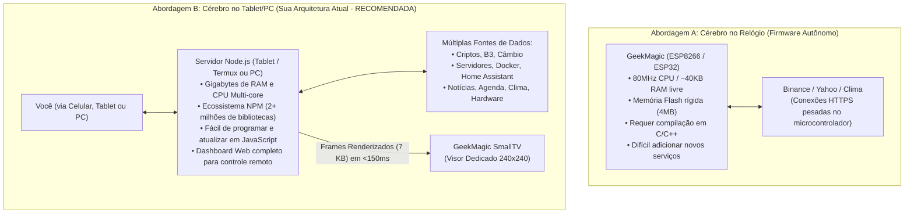
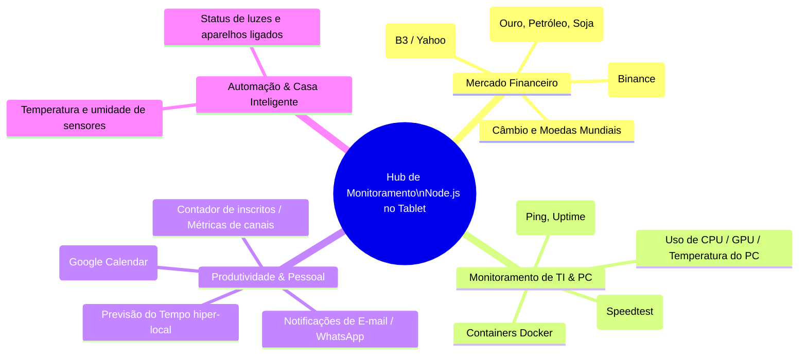

# Análise Estratégica: Arquitetura Thin-Client (Tablet/PC como Cérebro + GeekMagic como Visor)

## 1. Visão Geral da Proposta

A proposta do usuário é manter o **sistema próprio (Node.js no Tablet ou PC)** como o cérebro centralizador de inteligência e dados, utilizando o **GeekMagic SmallTV** estritamente como uma **tela física remota (Thin Client / Visor Inteligente)**.

> [!TIP]
> **Veredito:** Esta é a **melhor decisão técnica e arquitetural possível** para este projeto, especialmente considerando o desejo de adicionar novos recursos de monitoramento no futuro.

---

## 2. Comparativo: Cérebro no Relógio vs Cérebro no Tablet/PC

---

## 3. Por que esta abordagem é superior para o seu futuro?

| Aspecto | Firmware Embarcado no Relógio | Cérebro no Tablet / PC (Node.js) |
| :--- | :--- | :--- |
| **Poder de Processamento** | Muito limitado (~40 KB de RAM). Não aguenta lidar com múltiplos cálculos ou APIs pesadas. | **Praticamente ilimitado.** O tablet/PC consome gigabytes sem suar. |
| **Facilidade de Expansão** | Complexa: Exige programar em C++, gerenciar ponteiros de memória e regravar via cabo. | **Extremamente simples:** Basta adicionar novas funções em JavaScript no projeto. |
| **Ecossistema de Integrações** | Restrito a bibliotecas C++ específicas para microcontroladores. | **Infinito:** Acesso a todo o ecossistema Node.js (`npm`), WebSockets, bancos de dados, etc. |
| **Interface de Controle** | Telas estáticas sem painel interativo. | **Dashboard Web interativo:** Você clica no card do tablet e a tela do relógio muda na hora. |
| **Risco de Travamento do Hardware** | Alto: Bugs de código reiniciam o microcontrolador fisicamente. | **Zero:** Se uma API falhar, o Node.js trata a exceção e o relógio continua exibindo o último frame. |

---

## 4. O que você poderá adicionar no futuro usando essa arquitetura?

Com o Tablet rodando o Node.js 24/7 no Termux (com baixo consumo de energia), você pode transformar esse sistema em um **Hub de Monitoramento Universal**:

---

## 5. Próximos Passos de Evolução Sugeridos

1. **Fase 1 (Atual - Concluída com Sucesso):**
   - Sistema de mercado financeiro estável com 3 layouts visuais, compressão otimizada e responsividade para tablet/celular.
2. **Fase 2 (Próxima Expansão):**
   - **Sistema de Módulos (Plugins):** Permitir adicionar novos tipos de cartões no painel web (ex: "Card de Clima Local", "Card de Monitor de PC", "Card de Notícias").
   - **Alertas Sonoros no Tablet:** Como o relógio não tem alto-falante, o tablet pode emitir um alarme sonoro quando o Bitcoin ou o Dólar atingir uma meta definida por você!
3. **Fase 3:**
   - **Agendamento de Telas:** Exibir finanças durante o horário comercial (09h às 18h) e previsão do tempo / notícias à noite.
