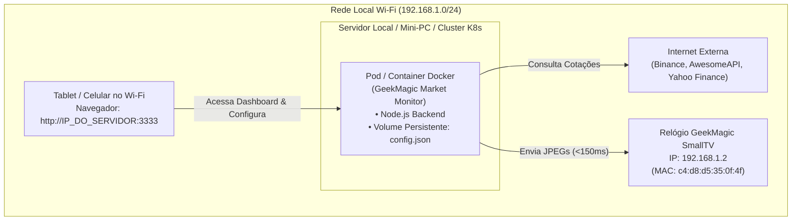

# Plano Técnico: Conteinerização com Docker e Orquestração com Kubernetes

## 1. Visão Geral da Arquitetura

O objetivo é transformar o **GeekMagic Market Monitor** em uma aplicação conteinerizada (*cloud-native*) que pode rodar em um servidor local, mini-PC, Raspberry Pi ou cluster Kubernetes (K8s/K3s), permitindo que você controle tudo pelo tablet ou qualquer dispositivo conectado ao Wi-Fi.



---

## 2. Como Funciona a Comunicação e o IP do Aparelho?

### O IP do Relógio continua o mesmo?
> [!IMPORTANT]
> **SIM!** O relógio GeekMagic continua conectado na sua rede Wi-Fi física com o IP local que ele tem hoje (ex: `192.168.1.2`). O container fará chamadas HTTP diretamente para esse endereço.

### Como garantir que o IP do relógio nunca mude?
Como o container precisará saber para onde mandar as imagens, a melhor prática do mercado é **travar o IP no seu roteador (DHCP Static Lease / Reserva de IP)**:
* Acesse o roteador e amarre o endereço MAC do seu relógio (`c4:d8:d5:35:0f:4f`) ao IP fixo desejado (ex: `192.168.1.2`).
* Dessa forma, mesmo que o relógio desligue da tomada ou a energia acabe, o roteador sempre atribuirá o mesmo IP para ele.

### Rede do Container (Networking no Docker / Kubernetes):
* **No Docker:** Use `network_mode: "host"` no Compose ou exponha a porta `-p 3333:3333`. Como o host está na rede `192.168.1.x`, o container consegue alcançar o relógio `192.168.1.2` de forma transparente.
* **No Kubernetes:** Para clusters locais (como **K3s** ou **MicroK8s**), use um Service do tipo `NodePort` ou `LoadBalancer` (MetalLB) para expor a porta 3333 para toda a sua rede local.

---

## 3. Especificações dos Arquivos de Implantação

### A. Dockerfile Otimizado Multi-Stage
```dockerfile
# Imagem base leve com Node.js 20 LTS
FROM node:20-slim

# Instala curl nativo e bibliotecas necessárias para o canvas gráfico
RUN apt-get update && apt-get install -y --no-install-recommends \
    curl \
    ca-certificates \
    && rm -rf /var/lib/apt/lists/*

WORKDIR /app

# Copia dependências primeiro para aproveitar o cache de build
COPY package*.json ./
RUN npm ci --only=production

# Copia o código da aplicação
COPY . .

# Expõe a porta do painel web
EXPOSE 3333

# Inicializa o servidor
CMD ["node", "server.js"]
```

### B. Docker Compose (Para uso direto sem Kubernetes)
```yaml
version: '3.8'

services:
  geekmagic-monitor:
    build: .
    container_name: geekmagic-monitor
    restart: unless-stopped
    network_mode: host # Garante comunicação direta com o IP do relógio na LAN
    volumes:
      - ./config.json:/app/config.json # Persiste seus ativos e configurações
    environment:
      - PORT=3333
      - NODE_ENV=production
```

### C. Manifesto Kubernetes (`k8s-deployment.yaml`)
```yaml
apiVersion: apps/v1
kind: Deployment
metadata:
  name: geekmagic-monitor
  labels:
    app: geekmagic-monitor
spec:
  replicas: 1 # Apenas 1 réplica para evitar concorrência no IP do relógio
  selector:
    matchLabels:
      app: geekmagic-monitor
  template:
    metadata:
      labels:
        app: geekmagic-monitor
    spec:
      hostNetwork: true # Permite comunicação direta na LAN do relógio
      containers:
        - name: monitor
          image: geekmagic-monitor:latest
          imagePullPolicy: IfNotPresent
          resources:
            requests:
              memory: "128Mi"
              cpu: "100m"
            limits:
              memory: "256Mi"
              cpu: "300m"
          volumeMounts:
            - name: config-volume
              mountPath: /app/config.json
              subPath: config.json
      volumes:
        - name: config-volume
          persistentVolumeClaim:
            claimName: geekmagic-config-pvc
---
apiVersion: v1
kind: Service
metadata:
  name: geekmagic-monitor-svc
spec:
  type: NodePort
  selector:
    app: geekmagic-monitor
  ports:
    - port: 3333
      targetPort: 3333
      nodePort: 30333
```

---

## 4. Como será a sua experiência de uso no dia a dia:

1. **Ligando o Sistema:**
   - O Kubernetes (ou Docker) mantém o container rodando no seu servidor, ou você sobe com um comando simples (`docker compose up -d` ou `kubectl scale deployment --replicas=1`).
2. **Acessando pelo Tablet (ou qualquer celular na casa):**
   - Você abre o navegador no tablet e entra em:
     👉 `http://IP_DO_SERVIDOR:3333` (ou porta `30333` se for Kubernetes NodePort).
3. **Controle Total:**
   - Você vê o espelho do relógio na tela do tablet.
   - Pode adicionar novas ações ou criptos, trocar de layout (Fintech / Minimal / Trader) e clicar nos cards para mudar o visor do relógio em tempo real.
4. **Persistência dos Dados:**
   - Como o `config.json` fica montado em um Volume persistente, qualquer ativo adicionado pelo tablet fica salvo para sempre, mesmo se o container for recriado ou atualizado.
