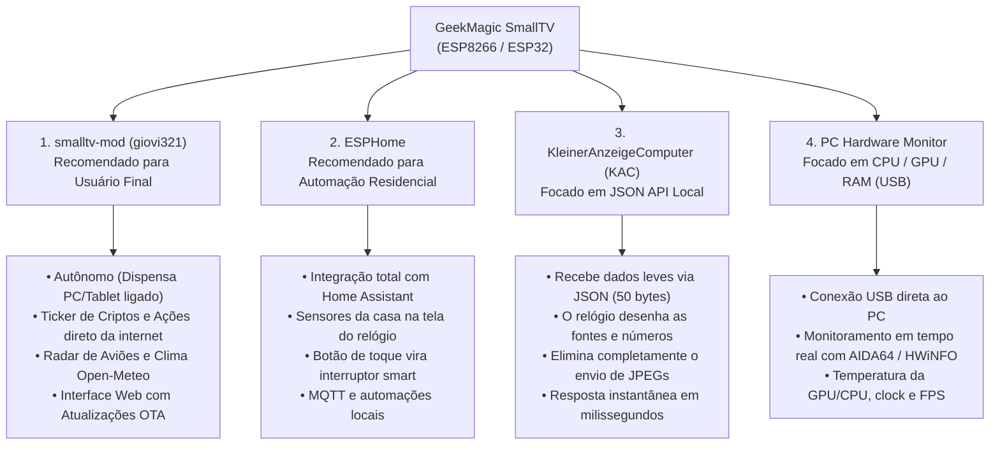

# Estudo de Viabilidade & Plano: Troca de Firmware do GeekMagic SmallTV

## 1. É possível trocar o firmware deste aparelho?

> [!IMPORTANT]
> **SIM, 100% possível e amplamente suportado pela comunidade open-source!**
> O GeekMagic SmallTV (modelos com tela 240×240 IPS) utiliza microcontroladores da família Espressif (**ESP8266EX** na versão Ultra/Weather e **ESP32** na versão Pro/S3).
> Ele possui uma controladora USB-Serial integrada (CH340 ou CP2102), o que significa que **não é necessário abrir a carcaça nem fazer solda**: qualquer computador consegue regravar a memória Flash diretamente através do cabo USB-C.

---

## 2. Limitações do Firmware Original de Fábrica

O software original que vem gravado no aparelho foi projetado para um uso muito limitado:
1. **Servidor Web Monotarefa e Frágil:** A pilha HTTP de fábrica trava ou rejeita conexões quando recebe muitas requisições ou arquivos maiores que 10 KB.
2. **Dependência de Servidor Externo para Cotações:** O firmware original não sabe calcular nem buscar cotações da Binance/B3 sozinho — ele apenas aceita receber imagens JPEG prontas enviadas pelo computador ou tablet.
3. **Serviços de Tempo e Clima Obsoletos:** Depende de servidores da China que frequentemente ficam fora do ar ou não encontram cidades brasileiras.
4. **Sem Segurança ou Criptografia:** Falta suporte a HTTPS e autenticação robusta.

---

## 3. Melhores Firmwares Alternativos do Mercado



### Detalhamento dos Firmwares:

### Opção A: `giovi321/smalltv-mod` *(A melhor opção para uso geral)*
* **Repositório:** [github.com/giovi321/smalltv-mod](https://github.com/giovi321/smalltv-mod)
* **O que muda:**
  - **Aparelho 100% Independente:** Ele conecta no Wi-Fi e busca as cotações financeiras, clima e relógio diretamente nas APIs pela internet. **Você não precisa deixar nenhum computador ou tablet ligado rodando servidor!**
  - **Recursos Nativos:** Ticker de criptoativos, radar de aviões ao vivo (ADSB), contador de inscritos/uso de IA (Claude/ChatGPT), previsão do tempo via Open-Meteo.
  - **Atualizações OTA:** Depois de gravado a primeira vez por cabo, todas as próximas atualizações são feitas pelo próprio navegador via Wi-Fi.

### Opção B: `ESPHome` *(Para quem usa Home Assistant)*
* **Repositório:** [github.com/Githubtezla/smalltv-pro-esphome](https://github.com/Githubtezla/smalltv-pro-esphome)
* **O que muda:**
  - O relógio vira um painel de bordo inteligente da sua casa.
  - Exibe temperatura de quartos, se há portas abertas, consumo de energia em Watts, etc.
  - O sensor de toque no topo pode acender uma lâmpada inteligente ou disparar um alarme no Home Assistant.

### Opção C: `KleinerAnzeigeComputer` (JSON API) *(Para quem quer integrar com sistemas próprios)*
* **Repositório:** [github.com/GiT-BeDa/KleinerAnzeigeComputer](https://github.com/GiT-BeDa/KleinerAnzeigeComputer)
* **O que muda:**
  - Em vez do nosso servidor Node.js gastar processamento renderizando um JPEG de 7 KB e fazendo upload via `curl`, o Node.js envia apenas um JSON minúsculo de 50 bytes:
    `{"symbol":"BTC","price":"92.450","color":"green"}`.
  - O processador do próprio relógio desenha na tela com taxas de quadros fluidas e **zero chance de erro de rede**.

---

## 4. O Passo Mais Importante: Backup Completo da Fábrica

> [!CAUTION]
> **Antes de qualquer tentativa de gravação, faremos o backup binário integral (Dump) da Flash original.**
> Com o arquivo `.bin` de fábrica salvo no seu computador, o risco de "brickar" o aparelho é **zero**, pois basta regravar o dump original e ele volta exatamente ao estado de fábrica da GeekMagic.

### Comando de Backup via `esptool.py`:
```bash
# 1. Identificar o chip e tamanho da Flash
esptool.py --port COMx flash_id

# 2. Fazer a cópia idêntica de toda a memória (4MB)
esptool.py --port COMx read_flash 0x0 0x400000 backup_original_geekmagic.bin
```

---

## 5. Roteiro de Decisão e Próximos Passos

1. **Definição de Objetivo:**
   - Deseja que o aparelho funcione **completamente sozinho** sem precisar de PC ou tablet ligado? 👉 Recomendado: `giovi321/smalltv-mod`.
   - Deseja manter o nosso painel Node.js no tablet, mas com comunicação via **JSON ultra-leve** em vez de imagens JPEG? 👉 Recomendado: Firmware com API local (KAC).
   - Deseja integrar na sua **automação residencial**? 👉 Recomendado: `ESPHome`.

2. **Execução Prática:**
   - Realizar o backup de segurança da memória original via USB.
   - Gravar o novo firmware escolhido usando o gravador oficial Web Serial ou `esptool.py`.
