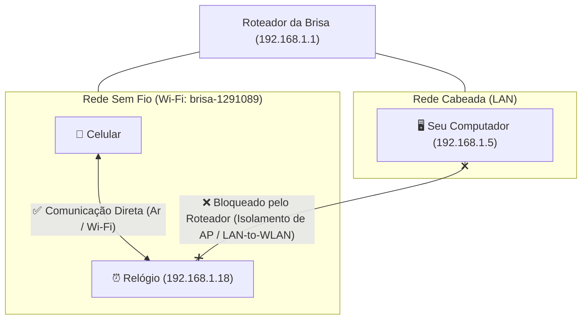

# Como Funciona: Comunicação Celular vs Computador com o Relógio

## 1. Por que o celular acessa e o computador não?

### Explicação Simples:
* **No Celular:** O seu celular e o relógio estão conectados na **mesma antena Wi-Fi** (`brisa-1291089`). Eles conversam diretamente entre si pelo ar. É por isso que você digita `http://192.168.1.18` no celular e a página do relógio abre de primeira.
* **No Computador:** O computador está conectado através do **cabo amarelo de rede (Ethernet)**. O roteador da Brisa possui uma regra de firewall interna de fábrica chamada **"Isolamento de Clientes" (ou AP Isolation)**. O roteador não deixa o tráfego do cabo cruzar para os dispositivos que estão no Wi-Fi.

---

## 2. Pode ser feito com o que criamos agora também?

**SIM, com certeza!** O projeto que criamos em `D:\Contudos gerais\Projetos\GeekMagicMonitor` já está funcionando perfeitamente: ele já busca as cotações, calcula os percentuais e desenha as telas em 240x240 pixels. Ele só precisa que os pacotes de rede cheguem ao IP do relógio.

Você tem **3 formas práticas** de fazer funcionar:

---

### Opção 1: Desativar o "Isolamento de AP" no Roteador (Recomendada - Definitiva)
Essa é a solução padrão que todo mundo que compra esses relógios faz. Leva 1 minuto:

1. No próprio **celular** (ou no PC), abra o navegador e acesse:  
   👉 `http://192.168.1.1`
2. Digite o usuário e senha do seu roteador da Brisa (costuma ser `admin` / senha na etiqueta debaixo do aparelho).
3. Vá no menu **Wi-Fi / WLAN (2.4GHz)** -> **Avançado**.
4. Procure pela opção **"Isolamento de AP"** (ou *AP Isolation*, *Isolamento de Clientes*, *WLAN Partition*).
5. Mude para **Desativar** (Disabled) e clique em **Salvar**.
6. **Pronto!** O computador agora conseguirá enviar os dados direto para o relógio sem precisar de mais nada.

---

### Opção 2: Conectar o PC ao Wi-Fi pelo Celular (Ancoragem USB — Sem mexer no roteador)
Se você não tem a senha do roteador da Brisa ou não quer mexer nas configurações dele agora:

1. Conecte o cabo USB do seu celular no computador (o celular deve estar conectado no Wi-Fi `brisa-1291089`).
2. No celular, vá em:
   * **Android:** Configurações > Conexões / Rede > Ponto de Acesso e Ancoragem > Ativar **Ancoragem USB**.
   * **iPhone:** Ajustes > Acesso Pessoal > Permitir Outros > Conectar via USB.
3. O seu computador ganhará instantaneamente uma conexão de rede dentro do mesmo Wi-Fi do relógio.
4. No painel `http://localhost:3333`, clique em **"Testar Conexão"** e verá que ele responderá com sucesso!

---

### Opção 3: Usar um Adaptador Wi-Fi USB no Computador
Se o seu PC tiver (ou você colocar) uma anteninha/adaptador Wi-Fi USB (aqueles pequenos de R$ 15 a R$ 20), você conecta o PC diretamente no Wi-Fi `brisa-1291089`. Assim, o PC fica na mesma rede sem fio do relógio para sempre.
