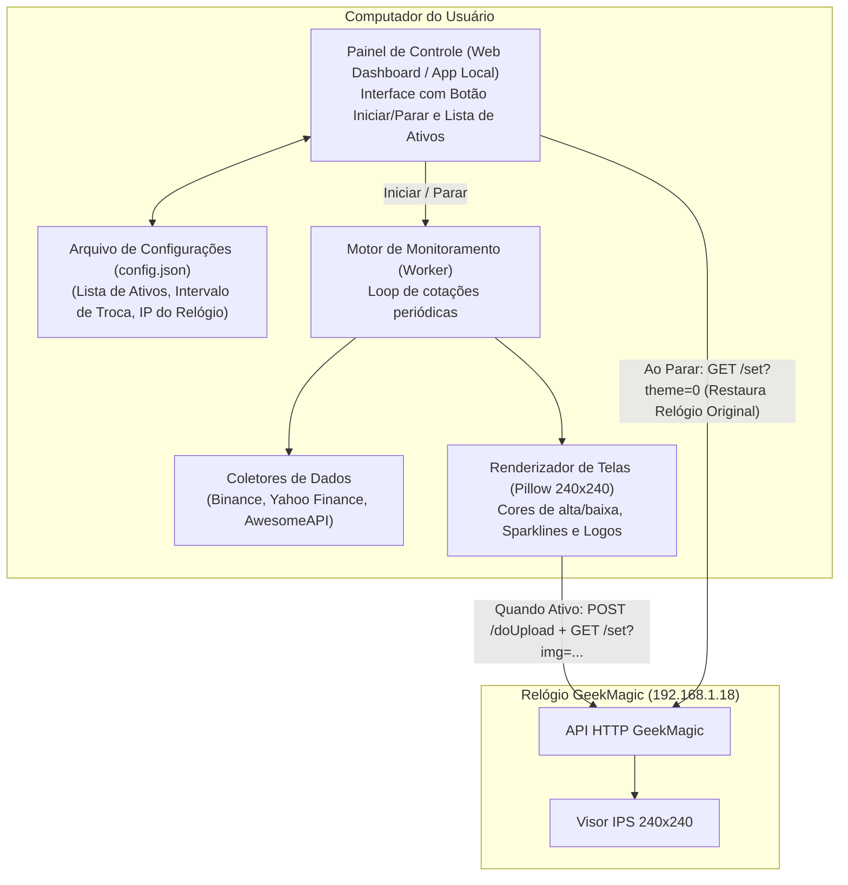

# Plano de Implementação: GeekMagic Market Monitor Dashboard

## 1. Visão Geral do Projeto
Desenvolver um aplicativo com painel de controle interativo no computador do usuário para gerenciar o relógio **GeekMagic (ESP8266)**. 

### Principais Diretrizes:
1. **Comportamento Padrão (Ao ligar o PC):** O relógio permanece funcionando normalmente (modo de fábrica: hora, previsão do tempo padrão), sem interferência.
2. **Controle Sob Demanda:** O usuário abre o aplicativo quando quiser e clica em **"Iniciar Monitoramento"** (Run).
3. **Gestão de Ativos na Interface:** Adicionar e remover facilmente:
   * **Criptomoedas:** Bitcoin (BTC), Ethereum (ETH), Solana (SOL), etc.
   * **Ações Nacionais (B3):** PETR4, VALE3, ITUB4, IBOV, etc.
   * **Ações Internacionais / Índices:** S&P 500, Nasdaq, NVDA, AAPL, etc.
   * **Câmbio:** Dólar (USD/BRL), Euro (EUR/BRL).
4. **Retorno Automático ao Modo Normal:** Ao clicar em **"Parar"** ou fechar o aplicativo, o relógio recebe o comando para restaurar imediatamente o seu tema original de fábrica (`theme=0`).
5. **Pré-visualização em Tempo Real:** O painel no PC exibirá uma prévia visual da tela de 240x240 pixels que está sendo exibida no relógio físico.

---

## 2. Arquitetura do Sistema



---

## 3. Interface do Aplicativo (Painel de Controle)

O aplicativo terá uma interface gráfica local moderna e responsiva (rodando localmente via servidor web leve e abrindo automaticamente em janela limpa ou navegador):

### Funcionalidades da Interface:
* **Botão Liga / Desliga (Run / Stop):** 
  * **Verde (Rodando):** O motor envia as telas em rotação cíclica para o relógio a cada $X$ segundos.
  * **Vermelho (Parado):** O motor pausa e envia o sinal para o relógio voltar ao modo original de fábrica.
* **Gerenciador de Ativos:**
  * Campo de busca e adição rápida (ex: digitar `BTCUSDT`, `PETR4.SA`, `USDBRL`).
  * Botões de "Remover" e "Reordenar" ativos.
  * Seletor de intervalo de rotação de tela (ex: 5s, 10s, 15s).
* **Simulador / Preview do Relógio:**
  * Um espelho de 240x240 na tela do PC mostrando exatamente o que está aparecendo no aparelho físico em tempo real.
* **Status de Conexão:**
  * Indicador de ping e status do relógio no IP `192.168.1.18`.

---

## 4. User Review Required

> [!IMPORTANT]
> 1. **Local de Instalação:** Sugerimos criar o projeto em uma pasta dedicada de fácil acesso, como `C:\GeekMagicMonitor\` ou na pasta de usuário `C:\Users\wesll\GeekMagicMonitor\`, criando um atalho na Área de Trabalho com ícone intuitivo para abrir o painel com 1 clique.
> 2. **Formato da Interface:** Prefere que o painel abra como uma janela desktop nativa ou no navegador padrão através de um painel web local (`localhost:5000`)?

---

## 5. Proposed Changes

### Componente: GeekMagic Market Monitor

#### [NEW] `C:\Users\wesll\GeekMagicMonitor\config.json`
Armazena as configurações salvas pelo usuário:
```json
{
  "clock_ip": "192.168.1.18",
  "rotation_interval_seconds": 10,
  "assets": [
    {"type": "crypto", "symbol": "BTCUSDT", "name": "Bitcoin"},
    {"type": "crypto", "symbol": "ETHUSDT", "name": "Ethereum"},
    {"type": "fiat", "symbol": "USD-BRL", "name": "Dólar"},
    {"type": "stock", "symbol": "PETR4.SA", "name": "Petrobras"},
    {"type": "stock", "symbol": "^BVSP", "name": "Ibovespa"}
  ]
}
```

#### [NEW] `C:\Users\wesll\GeekMagicMonitor\market_service.py`
Módulo responsável por:
* Buscar cotações na Binance (cripto), AwesomeAPI (dólar/euro) e Yahoo Finance (ações/índices).
* Cálculo de variação percentual diária (24h) e preço atual formatado.

#### [NEW] `C:\Users\wesll\GeekMagicMonitor\screen_renderer.py`
Módulo que utiliza **Pillow (PIL)** para desenhar telas estilizadas de 240x240 pixels:
* Fundo escuro premium (#0d1117).
* Nome e símbolo do ativo em destaque.
* Preço formatado em fonte legível.
* Variação percentual com badge verde (+X.XX%) ou vermelha (-X.XX%).
* Mini-gráfico de tendência (*sparkline* das últimas 24 horas).

#### [NEW] `C:\Users\wesll\GeekMagicMonitor\app.py`
Servidor da interface gráfica com endpoints para:
* Adicionar/remover ativos da lista.
* Iniciar (`/start`) e parar (`/stop`) o ciclo de monitoramento.
* Obter a imagem atual de preview.

#### [NEW] `C:\Users\wesll\GeekMagicMonitor\Iniciar_Monitor.bat`
Atalho executável para a Área de Trabalho: ao dar dois cliques, inicializa o painel de controle e abre a janela do aplicativo para o usuário.

---

## 6. Plano de Verificação

### Testes Automatizados
1. **Teste de Coleta de Dados:** Executar `market_service.py` isoladamente para garantir que as APIs gratuitas retornem preços de Cripto, Dólar e Ações sem erro.
2. **Teste de Geração de Imagem:** Validar que `screen_renderer.py` gera arquivos JPEG válidos com exatamente 240x240 pixels.
3. **Teste de Comunicação com o Relógio:**
   * Testar o envio de imagem via `POST /doUpload` e ativação com `GET /set?img=...`.
   * Testar a restauração do modo original com `GET /set?theme=0`.

### Verificação Manual
1. Abrir o aplicativo pelo atalho.
2. Adicionar uma nova criptomoeda (ex: `SOLUSDT`) e verificar se ela entra na fila.
3. Clicar em **"Iniciar"** e ver a tela do relógio físico mudar para o monitor de mercado.
4. Clicar em **"Parar"** e comprovar que o relógio volta imediatamente a exibir o relógio/clima padrão de fábrica.
