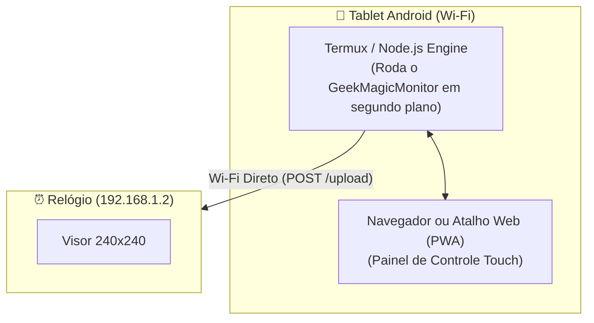

# Plano de Implementação: Normalização de Ativos, Novos Layouts e Execução no Tablet

## 1. Correção do Erro 400 na Binance (Cardano / ADA)

### Causa do Problema:
Na API da Binance, os ativos são negociados em **pares de troca** (como `ADAUSDT` ou `ADABRL`). 
Se o usuário digitar apenas `ADA` ou `CARDANO`, a Binance retorna:
```json
{"code": -1121, "msg": "Invalid symbol."} (HTTP 400)
```

### Solução Proposta (`market_service.js`):
Implementar um sistema de **normalização inteligente e mapeamento de nomes populares**:
1. Se o usuário digitar `ADA`, `Cardano` ou `ADA/USDT`, o sistema converte automaticamente para **`ADAUSDT`**.
2. Criar uma tabela de aliases para as 30 principais criptomoedas (ex: `cardano` ➔ `ADAUSDT`, `doge` ➔ `DOGEUSDT`, `ripple` ➔ `XRPUSDT`).
3. Adicionar o chip **`₳ Cardano (ADA)`** diretamente nos **Presets Rápidos** do painel para adicionar com 1 clique.

---

## 2. Adição de 2 Novos Layouts de Tela

Atualmente o sistema possui 1 estilo visual. Criaremos mais **2 layouts exclusivos de 240x240 pixels**, permitindo alternar no painel com 1 clique:

### Layout 1: "Fintech Clássico" (Atual)
* Tag do tipo (Crypto/Ação/Câmbio).
* Preço com ajuste dinâmico.
* Pílula de variação 24h (+% ou -%) com cor verde/vermelha.
* Gráfico suave de tendência (*sparkline*) com preenchimento em degradê.
* Barra de rodapé com relógio e indicador de próximo ativo.

### Layout 2: "Minimalista / Big Numbers" (Novo)
* Foco total em legibilidade à distância na mesa.
* Tipografia gigante e limpa para o preço centralizado.
* Nome do ativo e badge discreto de alta/baixa.
* Valor da variação diária em moeda (ex: `+$1,240` ou `-$0.05`).
* Estilo visual *Apple / Bauhaus* escuro.

### Layout 3: "Trader Pro / Terminal" (Novo)
* Estilo terminal Bloomberg / TradingView.
* Fundo escuro com grade milimétrica sutil.
* Tickers de abertura, máxima, mínima e fechamento (O / H / L / C).
* Gráfico de barras de variação (*Candlestick / Volatility Bars*).
* Indicador de força de compra/venda em cores saturadas (verde neon `#00ff66` e vermelho vibrante `#ff3344`).

---

## 3. Como Rodar o Sistema no Tablet (Android)

Para que o tablet assuma o controle e envie os dados para o relógio **sem precisar ligar o computador**:



### Passo a Passo no Tablet:
1. **Instalar o Termux no Tablet:**
   * Baixar o [Termux via F-Droid](https://f-droid.org/packages/com.termux/) (gratuito e sem anúncios).
2. **Instalar o Node.js no Tablet:**
   * No Termux, digitar: `pkg update && pkg install nodejs git curl -y`
3. **Copiar a pasta do projeto para o Tablet:**
   * Colocar a pasta `GeekMagicMonitor` na memória do tablet.
4. **Executar:**
   * No Termux: `cd GeekMagicMonitor && node server.js`
5. **Acessar:**
   * Abrir o Chrome no próprio tablet em `http://localhost:3333`.
   * Salvar como atalho na tela inicial do tablet (ele se comporta exatamente como um aplicativo APK nativo).

---

## 4. Proposed Changes

### [MODIFY] `D:\Contudos gerais\Projetos\GeekMagicMonitor\market_service.js`
* Adicionar função `normalizeCryptoSymbol(symbol)` para converter `ADA`, `Cardano`, etc. em `ADAUSDT`.
* Tratar símbolos incompletos e erros 400 graciosamente.

### [MODIFY] `D:\Contudos gerais\Projetos\GeekMagicMonitor\renderer.js`
* Adicionar suporte aos 3 layouts:
  * `renderAssetScreen(asset, quote, meta, layout = 'fintech')`
  * `renderFintechLayout(...)`
  * `renderMinimalLayout(...)`
  * `renderTraderLayout(...)`

### [MODIFY] `D:\Contudos gerais\Projetos\GeekMagicMonitor\public\index.html` & `app.js`
* Adicionar seletor de Layout visual no painel:
  * *( ) Fintech Clássico | ( ) Minimalista | ( ) Trader Pro*
* Adicionar preset do **Cardano (ADA)** nos chips rápidos.

### [MODIFY] `D:\Contudos gerais\Projetos\GeekMagicMonitor\config.json`
* Adicionar campo `"layout": "fintech"` e pré-adicionar Cardano (ADA).

---

## 5. Plano de Verificação

### Testes Automatizados
1. Testar busca de Cardano: `ADA`, `ADAUSDT`, `cardano` e validar retorno de cotação sem erro 400.
2. Gerar e salvar imagens dos 3 layouts (`preview_fintech.jpg`, `preview_minimal.jpg`, `preview_trader.jpg`).
3. Validar se a alteração de layout no painel reflete imediatamente na tela.

### Verificação Manual
1. Abrir `http://localhost:3333`.
2. Trocar entre os 3 temas e observar o preview na tela do PC e no relógio.
3. Testar a adição do ativo Cardano (ADA).
