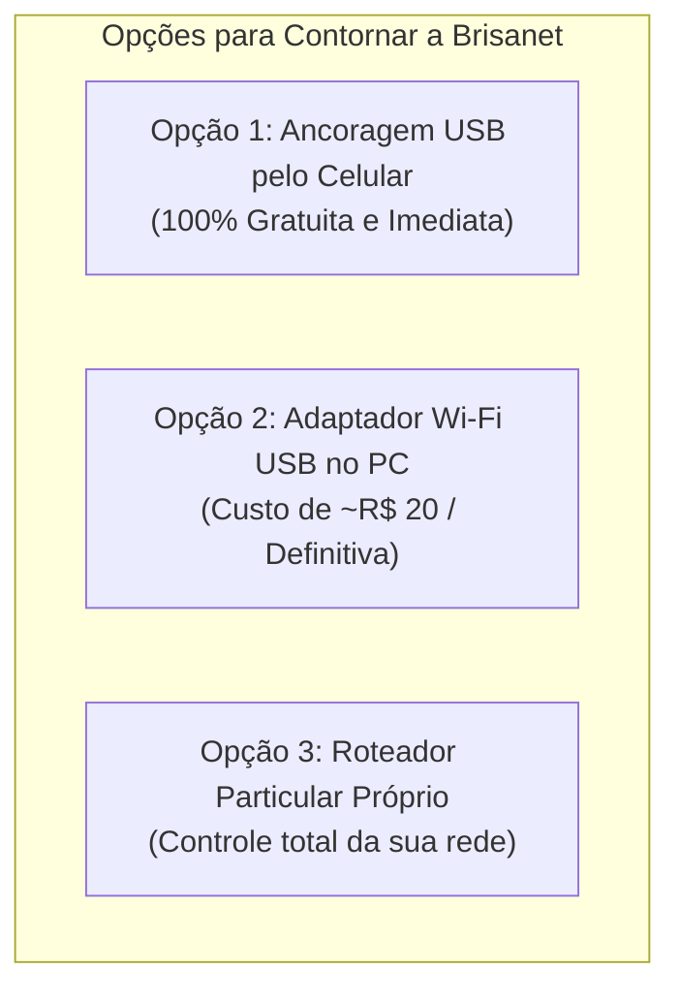

# Análise Brisanet: Bloqueio de Configurações e Como Contornar

## 1. A Brisanet permite alterar essa configuração?

> [!WARNING]
> **Na maioria dos casos, NÃO.**
> A Brisanet (assim como Claro e Vivo Fibra) utiliza **firmwares bloqueados e gerenciados remotamente** nas suas ONUs/Roteadores (modelos da Huawei, ZTE, Fiberhome ou Datacom):
> * O usuário comum só tem acesso ao aplicativo **Brisacliente** (que só permite trocar nome e senha do Wi-Fi).
> * O acesso web (`192.168.1.1`), quando não está bloqueado, costuma ter login com permissões restritas que **ocultam o menu avançado de Isolamento de AP (AP Isolation)**.
> * O suporte técnico de nível 1 geralmente não sabe ou não tem autorização para alterar parâmetros de isolamento de rede local.

Por isso, tentar alterar o roteador da Brisanet quase sempre se torna uma perda de tempo ou dor de cabeça.

---

## 2. Como resolver de forma simples e independente da Brisanet?

Não precisamos da Brisanet para fazer o sistema funcionar. Existem soluções práticas que você mesmo resolve em segundos:

---

### Solução 1: Ancoragem USB com o Celular (Imediata e Grátis)
Como o seu celular **já está conectado no Wi-Fi da Brisanet e conversa perfeitamente com o relógio**:
1. Conecte o cabo USB do seu celular no computador (com o celular no Wi-Fi `brisa-1291089`).
2. No celular, vá em:
   * **Android:** Configurações > Conexões > Ponto de Acesso e Ancoragem > Ativar **Ancoragem USB**.
   * **iPhone:** Ajustes > Acesso Pessoal > Conectar via USB.
3. O computador cria uma placa de rede virtual que pula o cabo e entra direto no mesmo Wi-Fi do relógio.
4. **Resultado:** O aplicativo no computador consegue enviar todas as cotações para o relógio no mesmo instante.

---

### Solução 2: Comprar um Mini Adaptador Wi-Fi USB para o Computador (~R$ 15 a R$ 25)
Se você não quiser ficar espetando o celular no PC no dia a dia:
* Aqueles mini adaptadores Wi-Fi USB (do tamanho de um receptor de mouse sem fio, padrão 2.4GHz) custam menos de R$ 25 em qualquer loja de informática ou no Mercado Livre/Shopee.
* Você espeta no PC, conecta na rede `brisa-1291089` e seu computador vira um membro nativo do Wi-Fi.
* Você não precisa mexer em nada na Brisanet e o monitoramento fica 100% autônomo.
